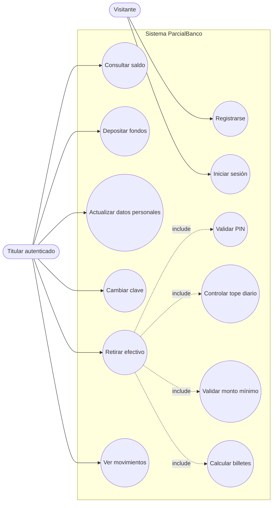
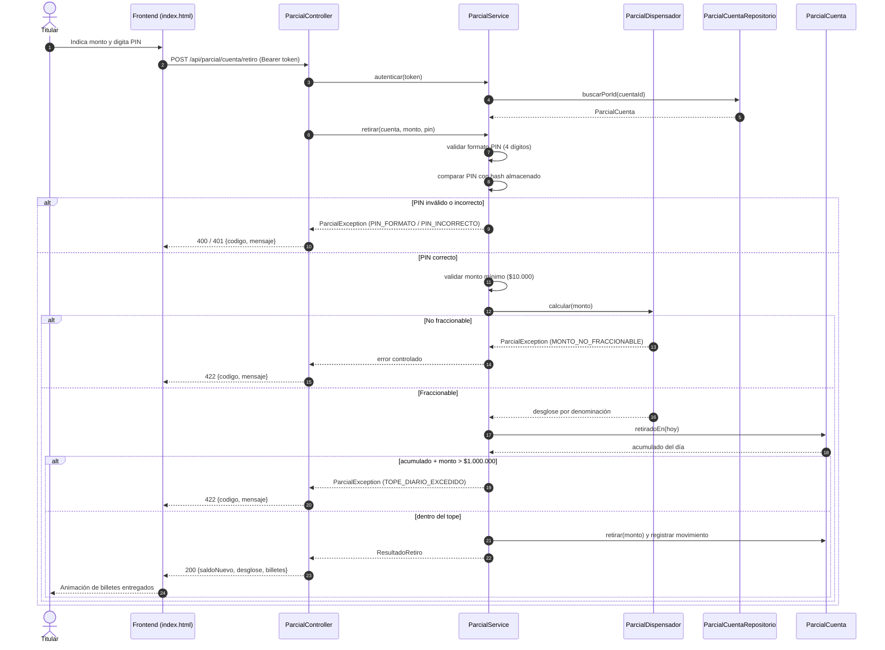
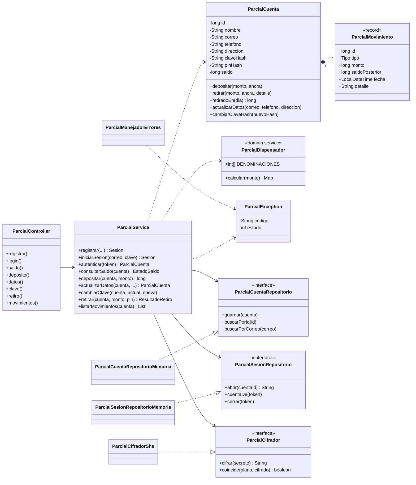
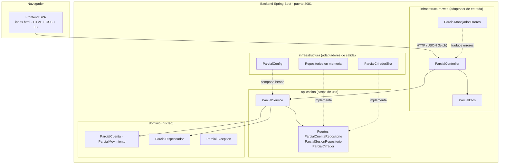

# ParcialBanco — Documentación del Parcial Final

**Asignatura:** Análisis y Diseño de Sistemas · Facultad de Ingeniería de Sistemas e Informática, UPB
**Versión del documento:** 1.0 · 4 de noviembre de 2026
**Repositorio:** compartido con el usuario `jjbrival93` · rama revisable: `main`
**Integrantes:** _(completar nombres)_

---

## 1. Observación y elicitación del cliente

> **Nota de alcance.** Esta minuta se construye a partir de la situación problema entregada en el parcial. Los roles consultados (operaciones, riesgo, tesorería de cajeros y atención en oficina) son representativos de una entidad financiera tradicional; no corresponden a entrevistas con personas reales.

### 1.1 Contexto de la entidad

La entidad atiende hoy sus operaciones de efectivo por varios canales que no comparten información: ventanilla, cajeros y una aplicación antigua que solo consulta. Cada canal lleva su propio registro y el cuadre se hace al cierre del día, a mano, cruzando planillas. Cuando algo no cuadra, la diferencia se descubre horas o días después, y para entonces el efectivo ya salió.

### 1.2 Lo que se escuchó en la sesión

**Operaciones.** El dolor más repetido fue el cierre diario. Un analista dedica buena parte de la mañana siguiente a reconstruir qué se retiró, dónde y por quién. Piden una sola fuente de verdad donde cada operación quede registrada en el momento en que ocurre, con su saldo posterior, de modo que el cuadre deje de ser una reconstrucción.

**Riesgo.** Su preocupación es el fraccionamiento: un cliente (o alguien con su tarjeta) puede retirar montos moderados en varios cajeros y oficinas durante el mismo día sin que ningún canal vea el total. Hoy no existe un acumulado diario por titular que se consulte antes de autorizar. Quieren que el sistema rechace el retiro que haría superar **$1.000.000 COP en la jornada**, sin excepciones manuales, y que el motivo del rechazo quede explícito.

**Tesorería de cajeros.** Cargan los cajeros con billetes de $100.000, $50.000, $20.000 y $10.000. Reportan que cuando la entrega no minimiza billetes, las denominaciones altas se agotan antes y las bajas sobran, lo que dispara los viajes de recarga. Piden que la dispensación use siempre la menor cantidad de billetes posible y que nunca intente entregar un valor que las denominaciones no puedan formar exactamente.

**Atención en oficina.** Una parte de las visitas son trámites que el cliente podría resolver solo: cambiar el correo, actualizar el teléfono o la dirección, cambiar la clave. También reciben reclamos por retiros "que no debieron salir" cuando el PIN se había compartido. Piden que el PIN sea de exactamente cuatro dígitos, se valide en cada retiro y que una clave de acceso distinta proteja el ingreso a la plataforma.

### 1.3 Problemas identificados

| # | Problema observado | Consecuencia | Respuesta del sistema |
|---|---|---|---|
| P1 | No hay acumulado diario por titular | Retiros fraccionados superan el riesgo tolerado | Control de tope diario de $1.000.000 COP por usuario |
| P2 | Retiros de montos muy pequeños saturan el cajero | Costo operativo sin valor | Monto mínimo de $10.000 COP |
| P3 | La entrega de billetes no se optimiza | Recargas frecuentes de denominaciones altas | Algoritmo de menor cantidad de billetes |
| P4 | Se intenta entregar montos que no se pueden formar | Errores en cajero y reclamos | Rechazo controlado explicando que debe ser múltiplo de $10.000 |
| P5 | PIN débil o compartido | Retiros no reconocidos | PIN de exactamente 4 dígitos validado en cada retiro |
| P6 | Trámites simples requieren ir a oficina | Filas y costo de atención | Autogestión de datos personales y clave |
| P7 | Cuadre manual al cierre | Errores y demora | Historial con saldo posterior por operación |

### 1.4 Riesgos transaccionales sin control

- **Fraccionamiento:** sin acumulado diario, el límite por operación no protege nada.
- **Concurrencia:** dos retiros simultáneos podrían leer el mismo acumulado y superar el tope juntos. El sistema los serializa por cuenta.
- **Entrega inexacta:** autorizar un monto que el cajero no puede formar deja una transacción a medio camino.
- **Secretos expuestos:** clave y PIN no pueden almacenarse en claro; se guardan con hash y sal.

### 1.5 Especificación de requerimientos

**Requerimientos funcionales**

| ID | Requerimiento |
|---|---|
| RF-01 | Registrar un titular con nombre, correo, teléfono, dirección, clave de acceso y PIN de 4 dígitos; la cuenta nace con saldo inicial de $2.000.000 COP. |
| RF-02 | Autenticar al titular con correo y clave, y emitir una sesión. |
| RF-03 | Consultar el saldo disponible y el acumulado retirado en la jornada. |
| RF-04 | Depositar fondos incrementando el saldo. |
| RF-05 | Actualizar correo, teléfono y dirección del titular. |
| RF-06 | Cambiar la clave de acceso validando la clave actual. |
| RF-07 | Retirar efectivo exigiendo PIN de exactamente 4 dígitos correcto. |
| RF-08 | Rechazar retiros menores a $10.000 COP. |
| RF-09 | Rechazar el retiro cuya suma con lo ya retirado en el día supere $1.000.000 COP. |
| RF-10 | Calcular la entrega con la menor cantidad de billetes de $100.000, $50.000, $20.000 y $10.000; si no es exacta, denegar indicando el motivo. |
| RF-11 | Listar los movimientos del titular, del más reciente al más antiguo. |

**Requerimientos no funcionales**

| ID | Requerimiento |
|---|---|
| RNF-01 | API REST en JSON sobre Spring Boot 3 / Java 17, puerto 8081. |
| RNF-02 | Arquitectura limpia: el dominio no depende de Spring ni de la persistencia. |
| RNF-03 | Clave y PIN almacenados con SHA-256 + sal aleatoria; comparación en tiempo constante. |
| RNF-04 | Operaciones que mueven saldo, atómicas por cuenta. |
| RNF-05 | Errores de negocio devueltos como `{codigo, mensaje}` con el motivo exacto. |
| RNF-06 | Frontend responsive, sin recargar la página, con retroalimentación visual inmediata. |
| RNF-07 | Zona horaria de la jornada: `America/Bogota`. |

**Supuestos y decisiones**

- Los montos son enteros en pesos (COP no usa decimales en esta operación), por lo que se usa `long`.
- La jornada se cuenta por día calendario en hora de Bogotá; el acumulado se reinicia a medianoche.
- "Supera $1.000.000" se interpreta de forma estricta: llegar exactamente a $1.000.000 está permitido.
- La persistencia es en memoria para el parcial; el puerto `ParcialCuentaRepositorio` permite cambiarla por JPA sin tocar el núcleo.
- El PIN se define al registrarse y no se puede consultar después.

---

## 2. Ciclo de vida del software

Se adopta un ciclo **iterativo e incremental con Scrum**. La razón es práctica: el núcleo de reglas del cajero es lo que más riesgo concentra, y conviene entregarlo y validarlo primero, dejando la interfaz y el pulido para iteraciones posteriores.

| Fase / Sprint | Objetivo | Entregable |
|---|---|---|
| Sprint 0 — Análisis | Elicitar, priorizar y estimar | Requerimientos, historias, criterios de aceptación |
| Sprint 1 — Núcleo | Dominio, puertos y reglas del cajero | Servicio con pruebas unitarias del dispensador y los topes |
| Sprint 2 — API | Controlador REST, errores, sesión | Endpoints funcionando en el puerto 8081 |
| Sprint 3 — Interfaz | Frontend y visualización de billetes | `index.html` conectado por `fetch` |
| Sprint 4 — Cierre | Documentación, diagramas, revisión de ramas | Entrega en `main` |

**Ceremonias:** planeación al inicio de cada sprint, revisión con demostración del incremento y retrospectiva corta. **Definición de terminado:** criterios de aceptación cumplidos, pruebas pasando, integrado en `develop` y verificado antes de pasar a `main`.

---

## 3. Historias de usuario con puntos y criterios de aceptación

Estimación en puntos de historia con escala de Fibonacci (1, 2, 3, 5, 8). Total: **32 puntos**.

### HU-01 · Registro de cuenta — 3 pts
*Como visitante quiero crear mi cuenta para operar de forma autónoma.*
- **Dado** que completo datos válidos y un PIN de 4 dígitos, **cuando** envío el registro, **entonces** se crea la cuenta con saldo de $2.000.000 COP y quedo con sesión iniciada.
- **Dado** que el correo ya existe, **cuando** envío el registro, **entonces** recibo el error `CORREO_DUPLICADO`.
- **Dado** que el PIN no tiene exactamente 4 dígitos numéricos, **cuando** envío el registro, **entonces** recibo `PIN_FORMATO`.

### HU-02 · Inicio de sesión — 2 pts
*Como titular quiero ingresar con mi correo y clave para ver mi panel.*
- **Dado** credenciales correctas, **cuando** inicio sesión, **entonces** obtengo un token de sesión y accedo al panel.
- **Dado** credenciales incorrectas, **cuando** inicio sesión, **entonces** recibo `CREDENCIALES_INVALIDAS` sin revelar cuál campo falló.
- **Dado** que no tengo sesión válida, **cuando** consulto una ruta protegida, **entonces** recibo `SIN_SESION` o `SESION_INVALIDA`.

### HU-03 · Consulta de saldo — 2 pts
*Como titular quiero ver mi saldo actual para decidir mis operaciones.*
- **Dado** que estoy autenticado, **cuando** consulto el saldo, **entonces** veo el saldo disponible, lo retirado hoy y lo que aún puedo retirar.
- **Dado** que realicé una operación, **cuando** vuelvo a consultar, **entonces** el saldo refleja el cambio al instante.

### HU-04 · Depósito de fondos — 2 pts
*Como titular quiero depositar dinero para aumentar mi saldo.*
- **Dado** un monto mayor a cero, **cuando** deposito, **entonces** el saldo aumenta exactamente en ese monto y queda un movimiento registrado.
- **Dado** un monto cero o negativo, **cuando** deposito, **entonces** recibo `MONTO_INVALIDO` y el saldo no cambia.

### HU-05 · Actualización de datos personales — 2 pts
*Como titular quiero cambiar mi correo, teléfono y dirección para mantener mis datos al día.*
- **Dado** datos válidos, **cuando** guardo, **entonces** el perfil se actualiza y puedo iniciar sesión con el nuevo correo.
- **Dado** un correo que pertenece a otra cuenta, **cuando** guardo, **entonces** recibo `CORREO_DUPLICADO`.
- **Dado** un correo o teléfono con formato inválido, **cuando** guardo, **entonces** recibo el error de validación correspondiente.

### HU-06 · Modificación de credenciales — 2 pts
*Como titular quiero cambiar mi clave de acceso cuando lo necesite.*
- **Dado** que la clave actual es correcta y la nueva cumple el mínimo de 6 caracteres, **cuando** la cambio, **entonces** la clave anterior deja de funcionar.
- **Dado** que la clave actual es incorrecta, **cuando** intento cambiarla, **entonces** recibo `CLAVE_ACTUAL_INCORRECTA`.
- **Dado** que la nueva clave es igual a la actual, **cuando** intento cambiarla, **entonces** recibo `CLAVE_REPETIDA`.

### HU-07 · Seguridad transaccional con PIN — 3 pts
*Como titular quiero que cada retiro exija mi PIN para evitar usos no autorizados.*
- **Dado** un PIN correcto de 4 dígitos, **cuando** retiro, **entonces** el retiro continúa con las demás validaciones.
- **Dado** un PIN incorrecto, **cuando** retiro, **entonces** recibo `PIN_INCORRECTO` y el saldo no cambia.
- **Dado** un PIN con menos o más de 4 dígitos, o con caracteres no numéricos, **cuando** retiro, **entonces** recibo `PIN_FORMATO`.

### HU-08 · Monto mínimo de retiro — 2 pts
*Como entidad quiero rechazar retiros menores a $10.000 para evitar operaciones sin valor.*
- **Dado** un monto menor a $10.000, **cuando** retiro, **entonces** recibo `MONTO_MINIMO` indicando el monto solicitado.
- **Dado** un monto de exactamente $10.000, **cuando** retiro, **entonces** el retiro es aceptado.

### HU-09 · Tope máximo diario — 5 pts
*Como entidad quiero limitar los retiros a $1.000.000 por usuario por jornada para controlar el riesgo.*
- **Dado** que ya retiré $950.000 hoy, **cuando** solicito $60.000, **entonces** recibo `TOPE_DIARIO_EXCEDIDO` indicando lo retirado y lo disponible, y el saldo no cambia.
- **Dado** que ya retiré $600.000 hoy, **cuando** solicito $400.000, **entonces** el retiro es aceptado y el acumulado queda en $1.000.000.
- **Dado** que llegué al tope, **cuando** solicito cualquier monto adicional, **entonces** se rechaza.
- **Dado** que cambia la jornada, **cuando** retiro, **entonces** el acumulado vuelve a cero.

### HU-10 · Dispensación con menor cantidad de billetes — 8 pts
*Como entidad quiero entregar el efectivo con la menor cantidad de billetes para cuidar el inventario del cajero.*
- **Dado** un retiro de $180.000, **cuando** se procesa, **entonces** se entregan 1 billete de $100.000, 1 de $50.000, 1 de $20.000 y 1 de $10.000 (4 billetes).
- **Dado** un retiro de $200.000, **cuando** se procesa, **entonces** se entregan 2 billetes de $100.000.
- **Dado** un monto que no es múltiplo de $10.000 (por ejemplo $15.000), **cuando** se procesa, **entonces** se rechaza con `MONTO_NO_FRACCIONABLE` y el saldo no cambia.
- **Dado** un retiro exitoso, **cuando** se muestra el resultado, **entonces** la interfaz presenta el desglose por denominación.

### HU-11 · Historial de movimientos — 3 pts
*Como titular quiero revisar mis operaciones para verificar mi actividad.*
- **Dado** que realicé depósitos y retiros, **cuando** abro el historial, **entonces** veo cada movimiento con tipo, monto, fecha y saldo posterior, del más reciente al más antiguo.
- **Dado** que aún no tengo movimientos, **cuando** abro el historial, **entonces** veo un mensaje indicándolo.

| Épica | Historias | Puntos |
|---|---|---|
| Acceso | HU-01, HU-02 | 5 |
| Cuenta | HU-03, HU-04, HU-05, HU-06, HU-11 | 11 |
| Cajero (módulo crítico) | HU-07, HU-08, HU-09, HU-10 | 16 |
| **Total** | 11 historias | **32** |

---

## 4. Diagramas

Los diagramas están en Mermaid; se visualizan en GitHub, GitLab, VS Code (con extensión) y en [mermaid.live](https://mermaid.live).

### 4.1 Diagrama de casos de uso



### 4.2 Diagrama de secuencia — retiro de efectivo



### 4.3 Diagrama de clases



### 4.4 Diagrama de componentes



**Regla de dependencias:** las flechas apuntan hacia el dominio. `dominio` no importa nada de Spring ni de `infraestructura`; `aplicacion` solo conoce el dominio y sus propios puertos.

---

## 5. Contrato de la API REST

Base: `http://localhost:8081/api/parcial` · Rutas protegidas: cabecera `Authorization: Bearer <token>`.

| Método | Ruta | Cuerpo | Respuesta |
|---|---|---|---|
| POST | `/registro` | `{nombre, correo, telefono, direccion, clave, pin}` | `201 {token, perfil}` |
| POST | `/login` | `{correo, clave}` | `200 {token, perfil}` |
| POST | `/logout` | — | `204` |
| GET | `/cuenta/perfil` | — | `{id, nombre, correo, telefono, direccion}` |
| GET | `/cuenta/saldo` | — | `{saldo, retiradoHoy, disponibleHoy, topeDiario}` |
| POST | `/cuenta/deposito` | `{monto}` | `{saldo, retiradoHoy, disponibleHoy, topeDiario}` |
| PUT | `/cuenta/datos` | `{correo, telefono, direccion}` | perfil actualizado |
| PUT | `/cuenta/clave` | `{claveActual, claveNueva}` | `204` |
| POST | `/cuenta/retiro` | `{monto, pin}` | `{monto, saldoNuevo, desglose, totalBilletes, retiradoHoy, disponibleHoy}` |
| GET | `/cuenta/movimientos` | — | lista de movimientos |

**Errores de negocio** (`{codigo, mensaje}`): `PIN_FORMATO`, `PIN_INCORRECTO`, `MONTO_MINIMO`, `MONTO_NO_FRACCIONABLE`, `SALDO_INSUFICIENTE`, `TOPE_DIARIO_EXCEDIDO`, `MONTO_INVALIDO`, `CORREO_DUPLICADO`, `CREDENCIALES_INVALIDAS`, `SIN_SESION`, `SESION_INVALIDA`, entre otros.

**Ejemplo de retiro**

```bash
curl -X POST http://localhost:8081/api/parcial/cuenta/retiro \
  -H "Authorization: Bearer <token>" -H "Content-Type: application/json" \
  -d '{"monto":180000,"pin":"1234"}'
# {"monto":180000,"saldoNuevo":1820000,"desglose":{"100000":1,"50000":1,"20000":1,"10000":1},"totalBilletes":4,...}
```

---

## 6. Estrategia de control de versiones (Git)

**Ramas**

| Rama | Propósito |
|---|---|
| `main` | Versión estable que se revisa y ejecuta para la calificación |
| `develop` | Integración: aquí se comprueba que todo funcione antes de pasar a `main` |
| `feature` | Rama de trabajo donde se desarrolla todo (el enunciado pide esta rama; si se divide por tema se puede nombrar `feature/<tema>`) |

**Flujo exigido:** `feature` → `develop` → `main`.

```bash
# 1. Inicializar y crear ramas
git init
git add .
git commit -m "chore: estructura inicial del proyecto"
git branch -M main
git branch develop
git branch feature

# 2. Trabajar SIEMPRE en feature
git switch feature
git add .
git commit -m "feat(cajero): validacion de PIN, tope diario y dispensador"

# 3. Integrar en develop y comprobar que funciona
git switch develop
git merge --no-ff feature -m "merge: feature en develop"
mvn test && mvn spring-boot:run        # verificar en develop

# 4. Mismo proceso hacia main (rama que se revisa)
git switch main
git merge --no-ff develop -m "release: version 1.0.0"
mvn test && mvn spring-boot:run        # verificar en main

# 5. Publicar las tres ramas
git remote add origin <URL-del-repositorio>
git push -u origin main develop feature

# 6. Compartir el repositorio con el docente:
#    GitHub > Settings > Collaborators > Add people > jjbrival93
```

**Convención de commits** (para el seguimiento de la elaboración del código): `feat:`, `fix:`, `test:`, `docs:`, `refactor:`, `chore:`. Se recomienda hacer commits pequeños y frecuentes en `feature` para que el historial muestre la evolución del trabajo.

**Historial sugerido para `feature`**

1. `chore: estructura del proyecto y pom`
2. `feat(dominio): cuenta, movimiento y excepcion de negocio`
3. `feat(dominio): dispensador de billetes con cambio minimo`
4. `feat(aplicacion): casos de uso de registro, sesion, saldo y deposito`
5. `feat(aplicacion): retiro con PIN, monto minimo y tope diario`
6. `feat(infra): repositorios en memoria, cifrador y configuracion`
7. `feat(api): controlador REST y manejo de errores`
8. `test: pruebas del dispensador y del servicio`
9. `feat(ui): frontend con cajero y animacion de billetes`
10. `docs: documentacion del parcial`

---

## 7. Pruebas

| Clase de prueba | Qué verifica |
|---|---|
| `ParcialDispensadorTest` | Menor cantidad de billetes (comparada con el método voraz para cada múltiplo de $10.000 hasta $1.000.000), suma exacta y rechazo de montos no fraccionables |
| `ParcialServiceTest` | Saldo inicial, retiro exitoso, PIN incorrecto o mal formado, monto mínimo, tope diario (incluido el borde exacto de $1.000.000), depósito, cambio de clave, actualización de datos y sesiones |

Ejecución: `mvn test`.

---

## 8. Cómo ejecutar

```bash
mvn clean spring-boot:run
# Abrir http://localhost:8081
```

Requisitos: Java 17 o superior y Maven 3.9+.
